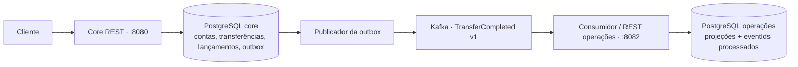

# CoopLedger

Back-end de uma cooperativa fictícia: contas, transferências internas em reais, razão contábil, conciliação e integração com Kafka. Java 21, Spring Boot 3.5.16, Maven, PostgreSQL, JPA, Flyway e Spring Security.

O exemplo inicial transfere **R$ 30 de uma conta com R$ 100 para outra com saldo zero**. A operação gera débito, crédito e evento na mesma transação. Um teste provoca uma falha depois que o débito chegou ao PostgreSQL e verifica o rollback completo.

## Executar

É necessário Docker com Compose v2. O build acontece dentro do contêiner; não precisa de Maven instalado.

```sh
cd CoopLedger # se estiver na pasta externa do workspace
cp .env.example .env
docker compose up --build -d --wait
python3 scripts/demo.py
```

O primeiro build baixa as imagens e as dependências. As portas publicadas ficam em localhost.

| Serviço | Endereço |
| --- | --- |
| Core / Swagger | http://localhost:8080/swagger-ui/index.html |
| Operações / Swagger | http://localhost:8082/swagger-ui/index.html |
| PostgreSQL core | localhost:15432 / banco coopledger |
| PostgreSQL operações | localhost:15433 / banco operations |
| Kafka para clientes no host | localhost:9092 |
| Prometheus, com perfil monitoring | http://localhost:9090 |
| Grafana, com perfil monitoring | http://localhost:3000 |

```sh
docker compose --profile monitoring up -d
docker compose logs -f core operations
docker compose down
```

Grafana: usuário `admin`, senha de demonstração `coopledger-demo` (configurável em `.env`). O dashboard **CoopLedger · Operação** é provisionado automaticamente. As portas de gerenciamento 9091 e 9093 ficam na rede Docker; Prometheus acessa essas portas diretamente.

### Autenticação local

Somente o perfil `local` oferece `POST /auth/token` e os dados fictícios. Ele é ativado pelo Compose.

| Usuário | Senha local | Subject / perfil |
| --- | --- | --- |
| alice | alice-demo | demo-alice / MEMBER |
| bob | bob-demo | demo-bob / MEMBER |
| ops | ops-demo | demo-ops / OPS |

```sh
curl -s http://localhost:8080/auth/token \
  -H 'Content-Type: application/json' \
  -d '{"username":"alice","password":"alice-demo"}'
```

Copie `accessToken` para o botão **Authorize** do Swagger. Tokens expiram em uma hora. As APIs validam assinatura HS256, emissor, audiência e expiração. Fora de `local`, não existe emissor de tokens público; configure `JWT_SECRET_BASE64` com pelo menos 32 bytes e integre um emissor de confiança. A chave e as credenciais deste exemplo são públicas e exclusivas da demonstração.

Contas locais: Alice `00000000-0000-0000-0000-000000000001` (R$ 100) e Bob `00000000-0000-0000-0000-000000000002` (R$ 0). O saldo inicial tem um lançamento `OPENING_CREDIT`; não há endpoint público para inventar saldo.

O script usa uma chave fixa e pode ser repetido sem novo débito. Ele demonstra transferência, repetição idêntica, conflito de chave, negação de acesso a outro titular, paginação, conciliação e atualização assíncrona em operações.

## APIs

| Método / caminho | Regra de acesso |
| --- | --- |
| POST /accounts | Titular cria para seu subject; OPS pode informar outro associado |
| GET /accounts/{id}/balance | Titular ou OPS |
| GET /accounts/{id}/statement?page=0&size=20 | Titular ou OPS; máximo 100 itens |
| PATCH /accounts/{id}/status | OPS; ACTIVE ou BLOCKED |
| POST /transfers | Titular da origem ou OPS; Idempotency-Key obrigatório |
| GET /transfers/{id} | Titular da origem, do destino ou OPS |
| POST /reconciliation-runs | OPS |
| GET /reconciliation-runs/{id} | OPS |
| GET /reconciliation-runs/{id}/divergences | OPS; paginado |
| GET /operations/transfers | OPS; paginado, banco do consumidor |
| GET /operations/transfers/{id} | OPS; pode retornar 404 enquanto o evento está pendente |

Abrir conta: `{"memberId":"demo-alice"}`. A conta começa ativa e com zero. Bloquear: `{"status":"BLOCKED"}`.

```http
POST /transfers
Authorization: Bearer <token>
Idempotency-Key: demo-transfer-30-v1
Content-Type: application/json

{
  "sourceAccountId": "00000000-0000-0000-0000-000000000001",
  "destinationAccountId": "00000000-0000-0000-0000-000000000002",
  "amount": 30.00,
  "description": "Pagamento de serviço"
}
```

Primeira execução: **201**, `Location` e `Idempotency-Replayed: false`. Repetição: **200**, mesma transferência e `Idempotency-Replayed: true`. Mesma chave com conteúdo diferente: **409**. Falhas retornam `application/problem+json` com um `code` estável. Valor inválido ou ausência de chave: 400; token ausente/inválido: 401; acesso indevido: 403; saldo insuficiente/conta bloqueada: 409.

Valores usam `BigDecimal` e `NUMERIC(19,2)`, são positivos e têm no máximo duas casas decimais e 17 dígitos inteiros. Não há arredondamento, tarifas, cheque especial ou transferência para a própria conta. A ordem do extrato é data e ID decrescentes.

## Arquitetura e garantias



- **Fronteira financeira:** a reserva da chave, as duas contas, a transferência, os dois lançamentos e a outbox usam a mesma transação PostgreSQL. Não há transação distribuída.
- **Concorrência:** dois `SELECT FOR UPDATE` em ordem lexicográfica dos UUIDs. O saldo é conferido com as contas bloqueadas; a segunda transação observa o saldo já atualizado.
- **Idempotência:** `PRIMARY KEY(actor_id, request_key)` e `INSERT ... ON CONFLICT DO NOTHING`. A inserção concorrente espera o commit/rollback da primeira. O fingerprint inclui origem, destino, valor normalizado e descrição exata. Chaves são mantidas sem expiração nesta versão. Operações rejeitadas revertem a reserva e podem ser tentadas novamente.
- **Histórico preservado:** triggers rejeitam UPDATE/DELETE de transferências e lançamentos. Uma constraint trigger diferida exige exatamente débito e crédito, com contas e valores corretos, no commit. Um estorno futuro deverá ser uma nova movimentação compensatória.
- **Entrega de eventos:** publicador usa `FOR UPDATE SKIP LOCKED`, aguarda confirmação do broker e só então marca a outbox. Falhas têm tentativas persistidas e backoff de até 256s. Uma queda entre a confirmação e o commit pode publicar de novo.
- **Consumo:** `eventId` tem chave primária. Deduplicação e projeção estão na mesma transação do banco de operações. O offset Kafka só avança depois do processamento. Falhas são repetidas sem descarte silencioso; um evento inválido bloqueia sua partição até intervenção.
- **Autorização:** titular é obtido do `sub` assinado e comparado ao proprietário da conta. Perfil OPS permite consultas operacionais e conciliação.
- **Conciliação:** soma entradas menos saídas em um snapshot REPEATABLE READ e registra saldo armazenado, saldo do razão e diferença. Não altera saldos.
- **Histórico de processamento:** a API de transferências mostra operações concluídas de forma síncrona. O processamento assíncrono é observado pela outbox, suas métricas e a projeção. Requisições recusadas não geram uma transferência persistida.

O módulo `shared` contém contrato do evento, validação monetária e infraestrutura HTTP/segurança comum; não compartilha entidades nem banco entre aplicações. O core se organiza por contas, transferências, razão, outbox e conciliação.

Decisões, custos e alternativas: [ADRs](docs/architecture.md).

## Testes e desenvolvimento

Requer JDK 21 e Docker em execução. O Maven Wrapper está incluído.

```sh
./mvnw test       # regras unitárias, sem Docker
./mvnw verify     # unitários + integrações com PostgreSQL e Kafka reais
```

No macOS com vários JDKs:

```sh
export JAVA_HOME=$(/usr/libexec/java_home -v 21)
./mvnw verify
```

A suíte de integração falha se o Docker não estiver disponível; não oculta cenários críticos como testes ignorados. Os contêineres e bancos de teste são temporários e não usam os volumes da demonstração.

| Cenário automatizado | Evidência |
| --- | --- |
| R$ 100 → transferência de R$ 30 | Saldos R$ 70/R$ 30, dois lançamentos e outbox |
| Saldo insuficiente | Nenhuma transferência, reserva, lançamento novo ou evento |
| Falha depois do débito flushado | Rollback inclusive do débito já visível dentro da transação |
| Mesma chave, sequencial e concorrente | Uma transferência; conflito para outro payload |
| Duas saídas de R$ 80 sobre R$ 100 | Uma aprovada, saldo final R$ 20 |
| Transferências em sentidos opostos | Ordem de locks consistente, conservação do total |
| Kafka pausado de verdade | Transferência confirma, evento continua pendente e publica após recuperação |
| Kafka entrega duplicada | Uma projeção e um registro de deduplicação |
| Falha no insert da projeção | Marca de deduplicação também reverte; retry funciona |
| Outro titular / token expirado | Acesso negado |
| Saldo corrompido em fixture | Divergência registrada sem correção automática |
| Mutação de histórico / transferência sem par | PostgreSQL rejeita no banco |

Para executar pela IDE, suba apenas as dependências:

```sh
docker compose up -d core-db operations-db kafka
./mvnw -DskipTests install
SPRING_PROFILES_ACTIVE=local DB_URL=jdbc:postgresql://localhost:15432/coopledger ./mvnw -pl core-service spring-boot:run
# Em outro terminal:
SPRING_PROFILES_ACTIVE=local DB_URL=jdbc:postgresql://localhost:15433/operations ./mvnw -pl operations-service spring-boot:run
```

## Operação e apresentação

[Guia de demonstração e recuperação](docs/demo.md). A pipeline em `.github/workflows/ci.yml` executa `verify` e guarda relatórios JUnit.

O dashboard acompanha transferências por resultado, latência p95, HTTP 5xx, quantidade/idade de eventos pendentes e consumo/duplicação. Contadores de transferência medem chamadas concluídas, repetidas, recusadas ou com erro; uma repetição não conta como nova movimentação financeira.

[Casos para issues e PRs](docs/issues.md) trazem reprodução, testes e correções presentes neste código. O desenvolvimento é revisado em PRs encadeados no [repositório GitHub](https://github.com/Marcosdovilio/CoopLedger/pulls), com uma issue para cada entrega.

Escopo entregue: etapas 1 a 5 do pedido. Etapa 6 permanece uma extensão planejada: cadastro legado com WireMock; exportação com SQS, worker e S3 privado; execução em ECS. A demonstração funciona localmente sem AWS.

Limites desta versão: dados e autenticação de demonstração; conciliação síncrona integral; paginação por offset; sem estornos, cadastro mestre de associados, recuperação automática de eventos inválidos, TLS/SASL Kafka ou implantação de produção. Em produção, separaria papéis de migração/runtime do banco, usaria um IdP e segregaria a rede de gerenciamento. Retenção Kafka e reconstrução das projeções também precisam de política operacional.

Referências: [locks PostgreSQL](https://www.postgresql.org/docs/17/explicit-locking.html), [Transactional Outbox](https://docs.aws.amazon.com/prescriptive-guidance/latest/cloud-design-patterns/transactional-outbox.html), [Testcontainers Kafka](https://java.testcontainers.org/modules/kafka/), [Spring Boot 3.5](https://docs.spring.io/spring-boot/3.5/system-requirements.html), [springdoc](https://springdoc.org/).
